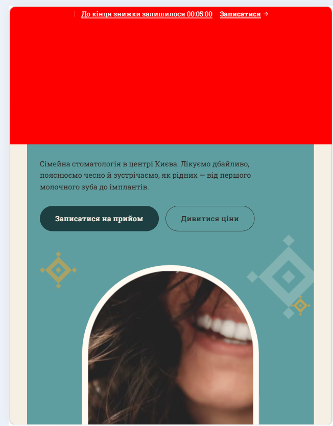
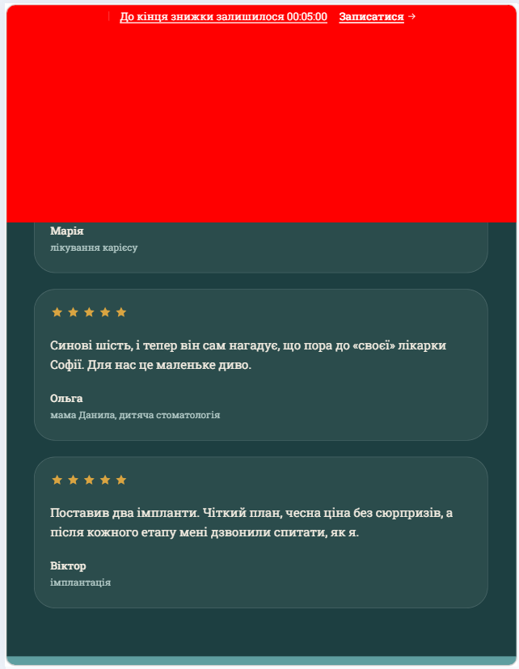
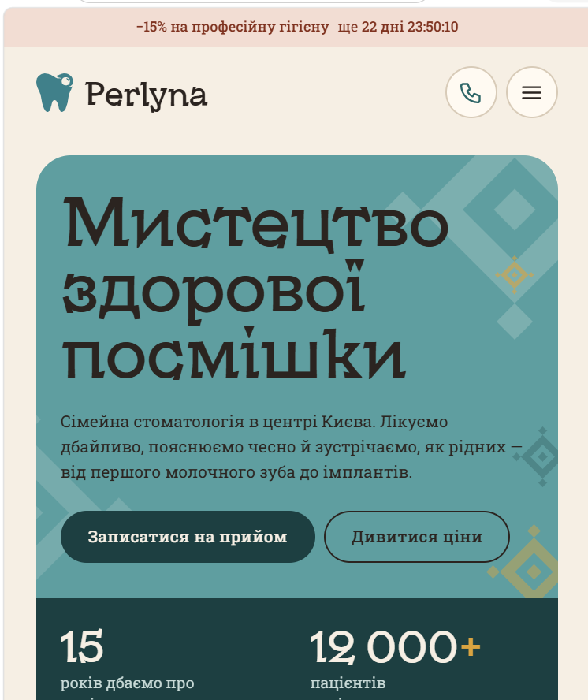
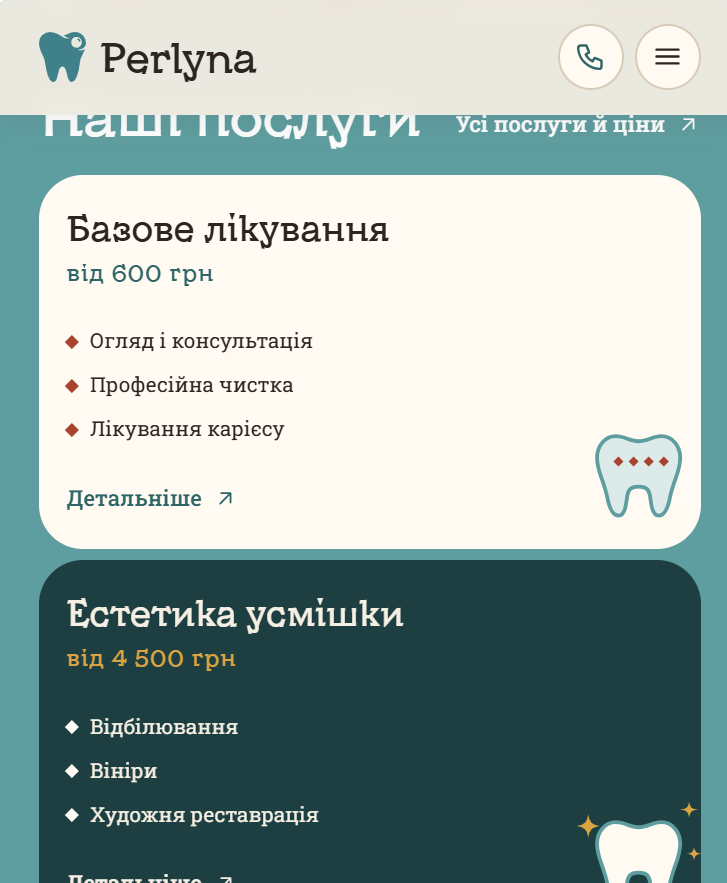

# Perlyna - сайт сімейної стоматології

Адаптивний сайт із 4 сторінок: головна, послуги й ціни, команда, контакти.
Зроблено на HTML, CSS та JavaScript, без збірки і без фреймворків.

## Посилання

- Сайт: [https://korshunovk1.github.io/perlyna-website/]
- Макет у Figma: [https://www.figma.com/design/JpQmNHG2Xv7eqVn1iIv5kM/Perlyna?node-id=0-1&p=f&t=SZRY243OK7scVebJ-0]
- Репозиторій: [https://github.com/korshunovk1/perlyna-website]

## Команда

| Учасник | Роль | Що зробив(ла) |
|---|---|---|
| Гаврильчак Софія | Дизайнер (візуал) | Макет сайту у Figma для Desktop, Tablet і Mobile, дизайн-система: кольори, шрифти, відступи |
| Прислупська Юлія | Дизайнер (UX) | Аналіз зауваження замовника, макети версії замовника і реалізоване рішення, висновок по забаганці |
| Козлов Іван | Верстальник | HTML-розмітка, CSS, адаптивна сітка, README |
| Коршунов Костянтин | Програміст | JavaScript: таймер, форми запису, меню, карусель; деплой, репозиторій |

## Сторінки

- `index.html` - головна
- `services.html` - послуги й ціни
- `team.html` - наша команда
- `contacts.html` - контакти й запис на прийом

## Як запустити

Збірка не потрібна, сайт працює як звичайні файли.

**Варіант 1. Відкрити файл**
1. Завантажте проєкт: `git clone https://github.com/korshunovk1/perlyna-website` або на GitHub натисніть Code - Download ZIP і розпакуйте архів.
2. Відкрийте папку проєкту і двічі клікніть `index.html`.

**Варіант 2. Через VS Code**
1. Встановіть розширення Live Server.
2. Натисніть правою кнопкою на `index.html` і виберіть Open with Live Server.

**Варіант 3. Через термінал**
1. У папці проєкту виконайте `python -m http.server 8000`.
2. Відкрийте у браузері `http://localhost:8000`.
## Change Log

### Зауваження замовника: банер знижки

**Що просив замовник:** червоний анімований банер у шапці на всіх сторінках із таймером «До кінця знижки залишилося 00:05:00». Банер має займати третину екрана і їхати за користувачем при прокручуванні.

**Наше рішення: часткове врахування (компроміс).** Ідею замовника ми залишили: знижка помітна на кожній сторінці, є таймер і швидкий перехід до запису. Форму ми змінили, бо вимога в початковому вигляді шкодить зручності й довірі до клініки.

### Що ми перевірили

Ми зробили вимогу як є: червоний банер, висота 1/3 екрана, закріплений при прокручуванні, таймер 00:05:00. Макет цієї версії є у Figma [Макет у Figma](https://www.figma.com/design/JpQmNHG2Xv7eqVn1iIv5kM/Perlyna?node-id=0-1&t=Xc7PcVitXOjtkFiY-1), а робочий прототип на скріншотах нижче.

### Чому не так, як просили

**Зручність і адаптивність (Responsive Grid)**

1. Закріплений банер на 33% висоти екрана постійно перекриває контент, зокрема заголовок «Запис на прийом».
2. На сторінці вже є закріплена шапка. Банер і шапка разом забирають ще більше місця. Приклад: телефон у горизонтальному положенні, екран 844×390. Банер 130 px плюс шапка близько 70 px залишають для контенту близько 190 px із 390, менше половини екрана.
3. На екранах 320 px і при збільшеному тексті місця для читання стає ще менше.

**Довіра до клініки**

1. Червоний банер виглядає як нав'язлива реклама, а стоматологія працює на довірі й спокої.
2. Таймер на 5 хвилин, який щоразу починає відлік заново, штучно створює терміновість. Користувач, який це помітить, перестане довіряти клініці.

### Що ми зробили замість цього
Невелика смужка над шапкою в кольорах сайту. У ній текст «-15% на професійну гігієну ...», таймер зворотного відліку до реальної дати завершення акції (30.11.2026). Уся смужка є посиланням на форму запису, а на комп'ютері є ще й окрема кнопка «Записатися». Смужка є на всіх 4 сторінках. Вона не закріплена: при прокручуванні сторінки йде вгору і зникає з екрана, тому не закриває контент.

### Що ми залишили з ідеї замовника
final-mobile.png
- Знижка помітна на кожній із 4 сторінок.
- Є таймер зворотного відліку і потрібний текст.
- Смужка веде прямо до форми запису: на комп'ютері кнопкою «Записатися», на телефоні кліком по всій смужці.

### Що ми змінили і чому

| Вимога замовника | Наше рішення | Причина |
|---|---|---|
| Червоний колір | Колір із палітри сайту | Єдиний стиль, довіра до клініки |
| Висота 1/3 екрана | Тонка смужка | Не закриває контент |
| Закріплений при прокручуванні | Не закріплена, зникає при прокручуванні | Не закриває контент і не конфліктує з шапкою |
| Анімований банер | Без анімації | Менше відволікання |
| Таймер 00:05:00 | Відлік до реальної дати | Чесність |

### Висновок

Замовнику потрібно, щоб відвідувачі помітили знижку й записалися на прийом. Наша смужка це забезпечує і не заважає читати сайт та заповнювати форму. Тому ми обрали компроміс замість банера на третину екрана.